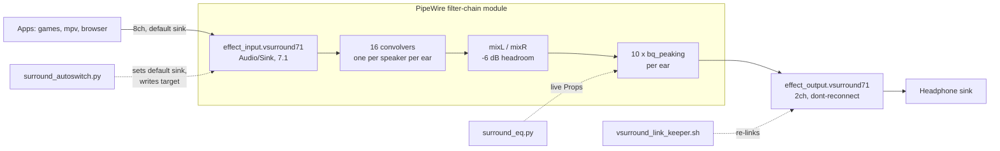

# pipewire-surround

Binaural 7.1 virtual surround for any stereo headphones on PipeWire, with automatic switching between headphones and speakers.

**Status:** working daily on the author's desktop (Arch-family Linux, PipeWire + WirePlumber). The headset-detection path is written for one headset family via `headsetcontrol`; other devices work through the "always on" or "priority device" modes. Head tracking is an idea, not built.

<!-- MEDIA: screenshot of the audio graph in qpwgraph or Helvum with a game/mpv playing: app -> effect_input.vsurround71 (8 ports) -> effect_output.vsurround71 (2 ports) -> the headphone sink. Crop to the three nodes. -->

## What it does

- Presents a real 8-channel (7.1) sink. Games, mpv, browsers and old Proton titles all get positional audio with no per-app support.
- Renders each speaker through an HRTF: either a SOFA database (true angles via libmysofa) or a HeSuVi impulse-response pack (Dolby Atmos for Headphones, DTS Headphone:X, GSX and so on).
- Switches itself: headset on means everything is surround; headset off (or speakers) means plain stereo, because HRTF audio on speakers sounds hollow.
- A 10-band EQ lives inside the filter graph and can be changed live without restarting anything.
- Keeps a separate hardware volume for headphone mode and speaker mode, so turning the speakers down no longer makes the headset quieter every day.
- Heals itself when the headset power-cycles.

## How it works



**The filter graph.** `surround_profile.py` generates a `libpipewire-module-filter-chain` config. For a HeSuVi pack (a 14-channel WAV: 7 speakers x 2 ears) each of the 8 inputs feeds two builtin convolvers, one per ear, picking the right WAV channel; the LFE reuses the centre's responses. For a SOFA database each speaker goes through a libmysofa `spatializer` node at its true azimuth (FL 30, FR 330, FC 0, RL 150, RR 210, SL 90, SR 270). Everything sums into a left and a right mixer, then through the EQ. The module runs in its own `filter-chain.service`, so switching profiles never restarts the main PipeWire daemon.

**Walls hit, and the fixes** (each cost a silent-audio debugging session):

- `channelmix.upmix = false` is deliberate. PipeWire upmixes stereo into 7.1 by default, so music was being faked into surround and then binauralised.
- `target.object` on the output stream is ignored silently and WirePlumber picked an HDMI sink. `node.target` plus `node.dont-reconnect = true` pins it. Never `node.passive`: that follows the default sink, which is the filter itself, and loops.
- Restarting the filter chain destroys the sink; anything playing is stranded on a dead node. `restart_gracefully()` parks streams on a fallback sink, restarts, waits for the new sink, then restores the default and moves streams back.
- Headroom. Measured with pink noise through the chain: 7.1 content gained 13.6 dB (eight convolved channels summing) and clipped at the 16-bit output. A -6 dB gain on the mixer inputs brought it to 7.6 dB with one multiply and no extra stage. Tunable as `headroom_db`.
- Resampling: HeSuVi impulse responses are 48 kHz, so the graph stays at 48 kHz and 44.1 kHz music is resampled; `examples/10-resample-quality.conf` raises the resampler quality to 10. Do not add 44100 to `clock.allowed-rates`, or the impulse responses get resampled instead.
- EasyEffects must stay out of the path: as a service it attaches to the default sink, and with the surround sink as default that is a feedback loop (total silence). The EQ was moved into the filter graph instead.

**Autoswitch.** `surround_autoswitch.py` polls once a second and takes the first match of: a priority device's sink present (surround to it), headset powered on (surround to the primary sink), otherwise plain stereo. Two consecutive identical readings are required before acting. Headset power comes from `headsetcontrol`'s `battery.level`, not `battery.status`: the status describes the base station, which is always plugged in. Level -1 means off, a transient 0 during handoff is ignored. When the target hardware changes it rewrites the chain config and restarts it gracefully.

**Per-mode volume.** On a wireless headset whose speakers hang off the base station's line-out, headphones and speakers are the same ALSA device with one volume. Volume keys move the default sink, so speaker turn-downs stuck to the headset while headset turn-ups only reached the capped filter, and the hardware ratcheted down to 24% (about -37 dB). The switcher now records the level per mode each poll and restores it on switch.

**The link keeper.** Because the output is pinned and set not to reconnect, a headset power-cycle (new node id on re-enumeration) leaves the chain "active (running)" with its output linked to nothing: sound enters the HRTF and falls off the end. This happened twice, once going unnoticed for two days, and a start-time check in the service cannot catch it. `vsurround_link_keeper.sh` watches `pw-link -m -l` events (30 s safety poll, 0.5 s debounce) and re-creates the links when missing, pairing ports by position rather than name since sinks do not all use FL/FR. It reads node name and target from the generated config, so there is one source of truth. It is silent when the chain is down or the headset is off.

## Workflow for this project

- The PipeWire traps above were found by an agent driving `pw-link`, `pactl` and live journals against the running graph, then recorded in a persistent memory note so later sessions did not repeat them.
- The headroom figures come from a measurement loop: known-level pink noise through the chain, recorded from the sink's monitor, before and after the change, rather than guessing.
- The link keeper was written after diagnosing a silent failure (zero links on a "healthy" service) and verified by killing the link and timing the restore.

## Requirements

PipeWire with the filter-chain module (a `filter-chain.service` user unit), WirePlumber, `pactl`, `pw-link`, `pw-cli`, Python 3. Optional: `headsetcontrol` (headset power detection), `rofi` (profile picker), libmysofa (SOFA profiles).

HRTF data is not included; the sets have their own licences. Get them yourself:
- HeSuVi impulse responses: the HeSuVi project (`HeSuVi/HRIR` folder). Put the WAVs in `<hrtf_dir>/hesuvi/hrir/`.
- SOFA: for example SADIE II (University of York) or the files shipped with libmysofa. Put `*.sofa` (48 kHz) under `<hrtf_dir>/`.

## Install and configure

```sh
mkdir -p ~/.config/surround ~/.local/bin ~/.config/systemd/user
cp examples/config.example.json ~/.config/surround/config.json   # edit sink names
cp examples/10-resample-quality.conf ~/.config/pipewire/client.conf.d/
ln -s "$PWD"/src/* ~/.local/bin/
cp systemd/*.service ~/.config/systemd/user/
surround.sh status          # find your sink name with: pactl list short sinks
surround_profile.py list
surround_profile.py set atmos
systemctl --user enable --now surround-autoswitch vsurround-link-keeper
```

`config.json` keys: `primary_sink` (hardware sink for the binaural output), `priority_sink_prefixes` (sinks that win when present, such as an earbud dongle), `headset_detect` (`headsetcontrol` or `always`), `headset_level` / `speaker_level` (remembered per-mode percent), `hrtf_dir`, `default_profile`, `headroom_db`, `eq_state`. Config path can be overridden with `SURROUND_CONFIG`.

## Usage

```
surround.sh test | profile [NAME] | run CMD... | alt CMD... | on | off | status
surround_profile.py list | current | set NAME [ALT_NAME]
surround_eq.py [apply|show]
```

The EQ reads `eq_state.json` (`{"enabled": true, "b1": 0, ... "b10": 0}`, gains in dB at 32 Hz to 16 kHz) from the runtime dir; any widget or script can write it, then run `surround_eq.py`. `examples/20-virtual-surround-71.generated-example.conf` shows what the generator writes; `systemd/filter-chain-verify-sink.conf.example` is a start guard that requires both ends of the sink to exist.

## Credits / licence

MIT, see LICENSE. HRTF sets belong to their respective authors (HeSuVi contributors, SADIE II / University of York, Neumann KU100 measurements, libmysofa).
